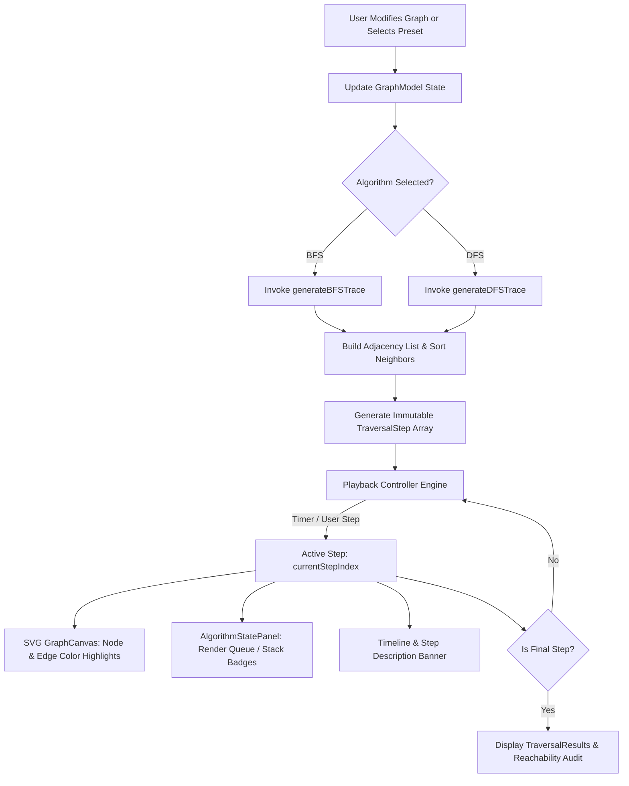
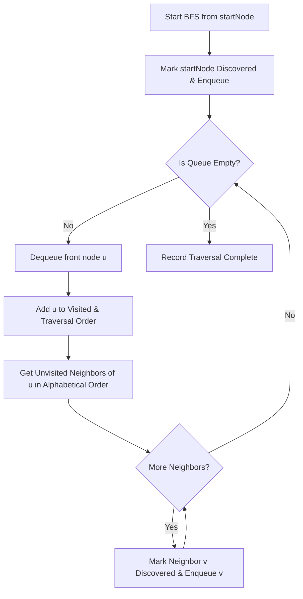
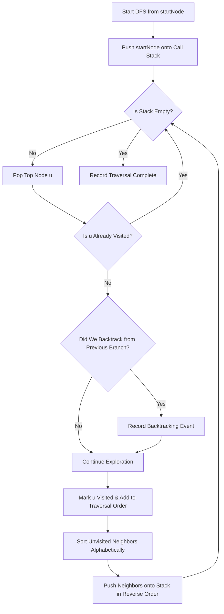

# GraphVista — Graph Traversal Visualizer

> **Tagline:** See Algorithms in Action.  
> An interactive educational web application designed to help computer science students, educators, and engineers intuitively understand graph traversal algorithms through step-by-step visual animation, live queue/stack inspection, and custom graph manipulation.

---

## 1. Introduction

**GraphVista** is a client-side, interactive graph algorithm visualizer built with modern React, TypeScript, and SVG rendering. It bridges the gap between abstract theoretical graph traversal descriptions and physical intuition by breaking down Breadth-First Search (BFS) and Depth-First Search (DFS) into observable, deterministic micro-steps.

Users can construct custom directed or undirected graphs, test edge cases such as cycles and disconnected components, adjust playback speed, inspect live data structures (FIFO Queue for BFS, LIFO Call Stack with backtracking for DFS), and evaluate time and auxiliary space complexity in real time.

---

## 2. Problem Statement

Graph traversal algorithms are foundational in computer science curricula and essential for software engineering interviews, network analysis, and AI pathfinding. However:
- Traditional textbooks and static diagrams show only the starting graph and the final traversal sequence, obscuring intermediary transitions.
- Students frequently struggle with the subtle mechanics of discovery vs. exploration, cycle detection, stack unrolling, and backtracking.
- Misconceptions regarding neighbor ordering, space complexity, and reachability in disconnected graphs persist when learners cannot experiment interactively.

GraphVista solves this educational hurdle by making every state change tangible, reproducible, and self-contained.

---

## 3. Project Objectives

1. **Deterministic Algorithmic Execution:** Provide accurate, pure TypeScript implementations of BFS and DFS adhering to a clear, documented neighbor-ordering policy.
2. **Interactive Graph Workspace:** Allow users to add vertices, connect directed/undirected edges, drag nodes to inspect topology, and delete items with immediate trace updates.
3. **Internal State Transparency:** Offer real-time visual inspection of the BFS Queue and DFS Stack, the visited set, active traversal edges, and the sequence order.
4. **Resilient Edge Case Exploration:** Gracefully handle empty graphs, single-node graphs, cycles, isolated vertices, and disconnected components.
5. **Zero Backend Dependency:** Ensure 100% client-side operation with zero external API keys or server latency.

---

## 4. Key Features

- **Interactive SVG Canvas:** Vector-rendered graph workspace with responsive coordinate transformation, drag-and-drop node positioning, and directional arrowheads.
- **Dual Algorithm Modes:**
  - **Breadth-First Search (BFS):** FIFO Queue visualization showing level-by-level frontier expansion and shortest unweighted path guarantees.
  - **Depth-First Search (DFS):** LIFO Call Stack visualization with explicit backtracking detection when retreating from dead ends.
- **Granular Playback Controls:** Play, pause, forward step, backward step, reset, and 4 playback speeds (0.5×, 1×, 1.5×, 2×).
- **Curated Topology Presets:**
  1. *Simple Connected Graph* (5 nodes)
  2. *Multi-Branch Tree* (7 nodes)
  3. *Graph with Cycles* (6 nodes with cross edges)
  4. *Disconnected Graph* (7 nodes across 2 disjoint components)
  5. *Directed Graph (DAG)* (6 nodes with directional paths)
  6. *Star & Hub Graph* (6 nodes)
- **Detailed Complexity Analysis:** Academic breakdown of $O(V + E)$ vs $O(V^2)$ across adjacency lists and adjacency matrices.
- **Live Disconnected Component Audit:** Automatically diagnoses unreachable nodes and alerts users that standard traversal is scoped to the root's connected component.
- **Keyboard Shortcuts & Accessibility:** ARIA live regions, semantic controls, and `Delete`/`Backspace` shortcuts.

---

## 5. Technology Stack

- **Core Framework:** React 19 (SPA Architecture)
- **Language:** TypeScript 5.8+ (Strict Type Checking)
- **Build Tool & Dev Server:** Vite 8.3
- **Styling:** Tailwind CSS 4.0
- **Vector Graphics:** Native Scalable Vector Graphics (SVG) with affine matrix coordinate transformations
- **Iconography:** Lucide React
- **Unit Testing:** Vitest 5.0

---

## 6. System Requirements

- **Node.js:** v18.0.0 or higher (v20+ recommended)
- **npm:** v9.0.0 or higher
- **Modern Web Browser:** Chrome 100+, Firefox 100+, Safari 16+, Edge 100+ with SVG 2.0 support

---

## 7. Installation Instructions

Clone the repository and install all required dependencies:

```bash
# Clone the repository
git clone <repository-url>
cd graphvista

# Install dependencies via npm
npm install
```

---

## 8. Development Setup

Start the local Vite development server:

```bash
npm run dev
```

The application will be accessible at `http://localhost:3000` (or the host port configured in your environment).

---

## 9. Project Folder Structure

```text
graphvista/
├── index.html                   # HTML entry point with metadata & typography
├── package.json                 # Project dependencies, scripts, and engine info
├── metadata.json                # AI Studio application metadata
├── tsconfig.json                # TypeScript compiler configuration
├── vite.config.ts               # Vite bundler and Tailwind configuration
├── tests/
│   └── traversal.test.ts        # Comprehensive Vitest suite for BFS/DFS edge cases
└── src/
    ├── main.tsx                 # React application mounting entry point
    ├── App.tsx                  # Top-level state coordinator & layout orchestrator
    ├── index.css                # Global styles and Tailwind CSS directives
    ├── types/
    │   └── graph.ts             # TypeScript definitions for Graph, Steps, and Metrics
    ├── utils/
    │   └── graphUtils.ts        # Adjacency list builder, deterministic sort, layout math
    ├── algorithms/
    │   ├── bfs.ts               # BFS trace generator with FIFO queue tracking
    │   └── dfs.ts               # DFS trace generator with explicit stack & backtracking
    ├── data/
    │   └── exampleGraphs.ts     # Predefined educational graph topology presets
    └── components/
        ├── Header.tsx           # Compact navigation bar with section anchors
        ├── Introduction.tsx     # Hero banner and visualizer jump action
        ├── GraphCanvas.tsx      # SVG canvas with pointer drag, arrows, and node states
        ├── GraphEditorToolbar.tsx # Node addition, connection, deletion, and mode controls
        ├── AlgorithmControls.tsx# Playback engine controls, speed selector, and timeline
        ├── AlgorithmStatePanel.tsx # Live Queue/Stack, Visited set, and Traversal order
        ├── TraversalResults.tsx # Traversal completion card with reachability audit
        ├── ComplexityCard.tsx   # Theoretical time & space complexity breakdown
        ├── LearningGuide.tsx    # Academic guide with BFS vs DFS comparison table
        └── Footer.tsx           # Academic footer and project credits
```

---

## 10. File and Directory Descriptions

| File / Folder | Role & Description |
|---|---|
| `src/types/graph.ts` | Central source of truth for `GraphModel`, `GraphNode`, `GraphEdge`, `TraversalStep`, and `TraversalResult`. |
| `src/utils/graphUtils.ts` | Pure functions for extracting adjacency maps, sorting neighbor lists deterministically by label, and calculating coordinates. |
| `src/algorithms/bfs.ts` | Computes the complete immutable array of traversal steps for Breadth-First Search using a FIFO queue. |
| `src/algorithms/dfs.ts` | Computes the step array for Depth-First Search with an explicit call stack and records backtracking steps. |
| `src/data/exampleGraphs.ts` | Stores 6 standard topological benchmarks: trees, cycles, DAGs, disconnected components, and hubs. |
| `src/components/GraphCanvas.tsx` | Renders crisp SVG nodes and edges with screen-to-viewBox transformation and touch event handling. |
| `src/components/AlgorithmControls.tsx` | Manages playback timers, step increments, timeline scrub, and live textual step descriptions. |
| `src/components/AlgorithmStatePanel.tsx` | Inspects current node, active queue/stack chips, visited status, and traversal sequence. |
| `tests/traversal.test.ts` | Validates correctness for cycles, disconnected subgraphs, isolated nodes, edge deletion, and directionality. |

---

## 11. Architecture Overview

GraphVista is engineered using an **Unidirectional Deterministic Pipeline**. Algorithm execution is strictly decoupled from UI rendering:

1. When a user creates or modifies a graph, or selects a new root vertex, the pure algorithm generator (`generateBFSTrace` or `generateDFSTrace`) immediately computes an immutable array of `TraversalStep` objects.
2. The playback engine maintains an index pointer (`currentStepIndex`).
3. Stepping forward, backward, or auto-playing updates this index pointer.
4. The canvas, state panel, and timeline simply project the state captured in `steps[currentStepIndex]`.

This design makes time-travel debugging (Previous Step) instant, glitch-free, and mathematically sound.

---

## 12. Architecture Flowchart



---

## 13. Graph Data Model

The graph is modeled using discrete, serializable TypeScript interfaces:

```typescript
export interface GraphNode {
  id: string;
  label: string;
  x: number;
  y: number;
}

export interface GraphEdge {
  id: string;
  source: string; // References GraphNode.id
  target: string; // References GraphNode.id
}

export interface GraphModel {
  nodes: GraphNode[];
  edges: GraphEdge[];
  directed: boolean;
}
```

---

## 14. BFS Algorithm Implementation

### Neighbor Ordering Policy
Neighbors of vertex $u$ are sorted alphabetically by their node label ($A < B < C \dots$) to ensure consistent traversal behavior across platforms.

### BFS Logic
1. Initialize empty FIFO `queue` and empty `visited` set.
2. Mark `startNode` as discovered, enqueue `startNode`, and record `START` step.
3. While `queue` is not empty:
   - Dequeue front vertex $u$. Mark $u$ as visited and append to `traversalOrder`.
   - For each neighbor $v$ of $u$ in alphabetical order:
     - If $v$ is not yet discovered:
       - Mark $v$ as discovered, add edge $(u, v)$ to traversal tree, and push $v$ into `queue`.
       - Record `DISCOVER_NEIGHBOR` step.
     - Else: Record `ALREADY_VISITED` step (cycle or cross-edge).
4. Record `COMPLETE` step with unreachable vertex audit.

### BFS Flowchart



---

## 15. DFS Algorithm Implementation

### Stack & Backtracking Logic
1. Initialize an explicit LIFO `stack` containing `{ nodeId: startNode.id, parentId: null }`.
2. While `stack` is not empty:
   - Pop top item $u$.
   - If $u$ is already visited, record step and skip (cycle defense).
   - If previous node is not the parent of $u$, record a `BACKTRACK` event.
   - Mark $u$ visited, append to `traversalOrder`, and add incident edge $(parentId, u)$ to tree.
   - Retrieve all unvisited neighbors of $u$ in alphabetical order.
   - **Stack Ordering Principle:** Push unvisited neighbors onto the stack in *reverse alphabetical order* so that the alphabetically earliest neighbor sits at the top of the stack and is popped first.
3. Terminate when stack is exhausted.

### DFS Flowchart



---

## 16. Traversal-Step Generation

Each recorded step captures a frozen frame of algorithm state:

```typescript
export interface TraversalStep {
  index: number;
  action: StepActionType;
  currentNode: string | null;
  activeEdgeId: string | null;
  visited: string[];
  frontier: string[];       // Queue elements for BFS, Stack elements for DFS
  traversalOrder: string[]; // Final visit sequence
  description: string;      // Human-readable summary
  detail?: string;          // Academic context
  treeEdges: string[];      // Edges forming the search tree
  backtrackingFrom?: string;
  backtrackingTo?: string;
}
```

---

## 17. Playback System

- Driven by a clean React `useEffect` interval hook.
- Automatically cleans up active intervals when paused, reset, or unmounted.
- Dynamically throttles interval duration based on selected multiplier:
  - **0.5×:** 1400 ms / step
  - **1.0×:** 800 ms / step
  - **1.5×:** 500 ms / step
  - **2.0×:** 300 ms / step
- Automatically halts when `currentStepIndex === steps.length - 1`.

---

## 18. Graph Editing Workflow

1. **Add Node:** Click "Add Node" or double-click anywhere on the canvas. Next available label ($A, B, C \dots$) is assigned automatically.
2. **Move Node:** Drag any node with mouse or touch. Connected edges update dynamically while keeping labels centered.
3. **Connect Nodes:** Click "Connect", select the source vertex, then click the target vertex.
4. **Delete Item:** Select any node or edge, then click "Delete Selection" or press `Backspace`/`Delete`. When a node is deleted, its incident edges are automatically pruned.
5. **Clear Graph:** Clears workspace with user confirmation.
6. **Toggle Directedness:** Instantly switch between undirected lines and directed arrowheads.

---

## 19. Complexity Analysis

| Algorithm | Representation | Time Complexity | Auxiliary Space Complexity | Notes |
|---|---|---|---|---|
| **BFS** | Adjacency List | $\mathcal{O}(V + E)$ | $\mathcal{O}(V)$ | Queue holds at most the maximum width of the search tree. |
| **BFS** | Adjacency Matrix | $\mathcal{O}(V^2)$ | $\mathcal{O}(V)$ | Inspecting neighbors requires iterating through a full matrix row of length $V$. |
| **DFS** | Adjacency List | $\mathcal{O}(V + E)$ | $\mathcal{O}(V)$ | Stack holds at most the maximum depth of the graph (worst case: linear chain). |
| **DFS** | Adjacency Matrix | $\mathcal{O}(V^2)$ | $\mathcal{O}(V)$ | Each vertex requires $V$ operations to locate incident edges. |

---

## 20. UI/UX Design Principles

- **Minimalist SaaS Aesthetic:** Slate-50 background (`#F8FAFC`), crisp white cards (`#FFFFFF`), subtle borders (`#E2E8F0`), and an Indigo-600 primary brand hue.
- **Accurate Visual States:**
  - **Unvisited:** White fill, Slate-400 border.
  - **Frontier (Queue/Stack):** Sky-100 fill, Sky-600 border.
  - **Current Node:** Amber-100 fill, Amber-500 border, animated pulse halo.
  - **Visited Node:** Emerald-100 fill, Emerald-600 border.
  - **Tree Edge:** Emerald-500 accent line.
- **Micro-Interactions:** Subtle scale transitions on button click and hover states.

---

## 21. Responsive Design

GraphVista adheres strictly to mobile-first responsive guidelines:
- Tested across viewports: `320px`, `360px`, `375px`, `390px`, `430px`, `768px`, `1024px`, and `1440px`.
- SVG uses `viewBox="0 0 800 480"` with `preserveAspectRatio="xMidYMid meet"`.
- Uses `svg.getScreenCTM()?.inverse()` to guarantee exact pointer-to-canvas coordinate mapping on high-DPI and scaled displays.
- Prevents accidental mobile page scroll during dragging via `touch-none`.

---

## 22. Accessibility (a11y)

- Semantic HTML5 structure (`<header>`, `<main>`, `<section>`, `<nav>`, `<footer>`).
- Fully labeled interactive elements with `aria-label` attributes.
- Floating notifications equipped with `role="status"` and `aria-live="polite"`.
- High color contrast meeting WCAG AA requirements (minimum 4.5:1 for body copy).
- Visual states backed by textual labels so color is never the sole information carrier.

---

## 23. Testing Instructions

Unit tests are implemented using **Vitest**:

```bash
# Run the complete test suite
npm test
```

### Verified Test Cases:
- **Test A:** Simple connected graph visit completeness for BFS and DFS.
- **Test B:** Termination on cyclic graphs without infinite looping.
- **Test C:** Reachability audit for disconnected subgraphs.
- **Test D:** Single-node isolated graph execution.
- **Test E:** Empty graph validation without runtime exceptions.
- **Test F:** Edge directionality enforcement in directed graphs.
- **Test G:** Automatic pruning of incident edges on node deletion.
- **Test H:** Deterministic alphabetical neighbor ordering validation.
- **Test I:** BFS level-order vs DFS deep-branch visit sequence comparison.

---

## 24. Build & Production Instructions

To verify TypeScript types and build optimized static production assets:

```bash
# Type check and lint
npm run lint

# Compile production bundle
npm run build
```

The output artifacts are bundled into the `/dist` directory.

---

## 25. Deployment Instructions

GraphVista is fully client-side and can be hosted on any static web server or CDN:
- **Vercel / Netlify:** Connect Git repository; build command `npm run build`, output directory `dist`.
- **GitHub Pages:** Deploy the `/dist` directory with standard Vite `base` configuration.
- **Cloud Run / Docker:** Serve static files via Nginx or Express (`tsx server.ts`).

---

## 26. Limitations

- **Graph Size:** Designed for academic graphs up to ~30 nodes for optimal visual clarity.
- **Edge Weights:** Current version focuses on unweighted graph traversals; Dijkstra's or Bellman-Ford algorithms are not included in this release.
- **Self-Loops:** Self-loops are prevented by design to preserve clear educational visualization.

---

## 27. Future Improvements

- Add Dijkstra's Algorithm and A* heuristic search for weighted graphs.
- Add Topological Sorting visualizer for Directed Acyclic Graphs (DAGs).
- Add Tarjan's or Kosaraju's Strongly Connected Components algorithm.
- Export graph topologies to JSON and import via file upload.

---

## 28. Academic Project Abstract

> Graph traversal is an indispensable pillar of discrete mathematics and computer science. Despite its prominence, static instructional media often fail to convey the dynamic interplay between data structures and graph topology. GraphVista introduces an interactive, browser-native platform that renders Breadth-First Search and Depth-First Search as deterministic, discrete step-by-step state machines. By exposing live queue and stack contents, providing tactile node repositioning, and diagnosing reachability in disconnected graphs, GraphVista significantly enhances conceptual comprehension and algorithmic intuition for students and educators alike.

---

## 29. Conclusion

GraphVista demonstrates that educational algorithm visualizers do not require bloated external dependencies or heavy backend servers. Built with clean, idiomatic React and TypeScript, it offers students an engaging, accessible, and scientifically accurate environment to see algorithms in action.

---

## 30. License Information

This project is open-source under the terms of the Apache-2.0 License. If a different license is preferred for your institution or organization, it can be configured in `package.json` and a corresponding `LICENSE` file.
